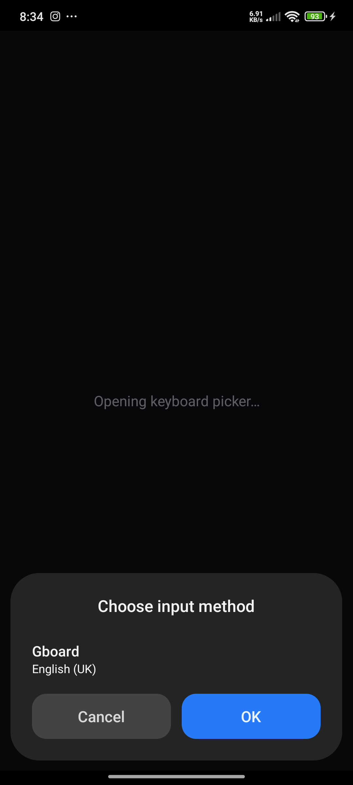

# Keyboard Picker

[](https://github.com/fynks/HyperOS-Keyboard-Picker/releases/latest)
[](https://github.com/fynks/HyperOS-Keyboard-Picker/actions/workflows/android.yml)
[](https://github.com/fynks/HyperOS-Keyboard-Picker/blob/main/LICENSE)

An Android launcher that opens the system's own keyboard chooser — the same
"Choose input method" dialog as the keyboard-switch button in the navigation
bar — with one tap from the home screen or the Quick Settings shade.

The activity calls exactly one public API:

```java
InputMethodManager imm = (InputMethodManager) getSystemService(INPUT_METHOD_SERVICE);
imm.showInputMethodPicker();
```



## What it does

- Opens Android's native keyboard chooser
- Closes itself as soon as you dismiss the chooser
- Adds an optional Quick Settings tile, so the chooser can be opened from the
  shade without going to the home screen

There are two ways in, and one implementation behind both:

- **Home-screen icon** — `MainActivity` calls
  `InputMethodManager.showInputMethodPicker()` directly.
- **Quick Settings tile** — `PickerTileService` does *not* touch the input method
  API. Android's tile integration collapses the shade and launches that same
  `MainActivity` via `startActivityAndCollapse`.

## What it does not do

- It does not switch to a keyboard for you — the choice is always yours
- It does not draw its own dialog or imitate the system one
- It does not open Settings
- It has no settings screen, no onboarding, no configuration
- It has no network access, no analytics and no ads
- It does not log anything

## Requirements and compatibility

**Minimum supported: Android 14 (API 34).** `minSdk` is 34; the app will not
install on anything older.

Two or more keyboards must be enabled, or the chooser lists a single entry:
*Settings → Additional settings → Languages & input → Keyboard management*.

| Configuration | Status |
|---|---|
| Android 14 / HyperOS 1 (API 34) | **Unverified** — permitted by `minSdk`, but never run on this hardware |
| Android 15 / HyperOS 2 (API 35) | **Verified** — chooser opened on 18/18 launches; Quick Settings tile 6/6 |
| Android 16+ (API 36+) | **Unverified** — `targetSdk` is held at 35 pending testing |

"Unverified" means the app is allowed to run there by `minSdk`, but no test was
performed on such a device. If you have one, please [open an issue](https://github.com/fynks/HyperOS-Keyboard-Picker/issues/new/choose).

`targetSdk` is deliberately 35 rather than 36: the chooser is the entire app, and
raising it without hardware to test on would risk the one behaviour that matters.

No runtime permissions are requested, because `showInputMethodPicker()` is
public API. The Quick Settings tile uses a system permission described under
[Privacy](#privacy).

## Install and use

### From a release

Download `app-release.apk` from the [Releases](../../releases) page, then:

```bash

## Install and use

Download `app-release.apk` from the [Releases](../../releases) page, then:

```bash
adb install -r app-release.apk
```

or copy the APK to the phone and open it (you will need to allow installs from
your file manager).

### Using it

**From the home screen:** tap **Keyboard Picker**, pick a keyboard, and the app
is gone.

**From Quick Settings:** pull the shade down, tap the pencil/edit icon, find
**Keyboard Picker**, and drag it into the tile area. Tapping it opens the same
chooser and collapses the shade. To remove it later, edit the shade again and
drag it back out.

> Releases are signed with a long-lived key and upgrade cleanly over each other.
> If you have a build installed that was signed with a *different* key (an early
> debug-signed build, or one from another machine), the install will fail with
> `INSTALL_FAILED_UPDATE_INCOMPATIBLE`. Remove the old copy first:
>
> ```bash
> adb uninstall com.fynks.keyboardpicker
> ```

## Troubleshooting

**Nothing appears when I tap the icon.**
The request was refused. This is the app's main failure mode and it is silent by
design. Check, in order:

1. *Are two or more keyboards enabled?* With only one, there is nothing to pick.
   *Settings → Additional settings → Languages & input → Keyboard management.*
2. *Are you on Android 14 or newer?* Anything below API 34 cannot install it.
3. On MIUI/HyperOS, try the per-app **"Display pop-up windows while running in
   the background"** setting (*Settings → Apps → Keyboard Picker → Other
   permissions*). Not normally required, since the activity is foreground when the
   request is made, but it is the first thing to try on heavily modified ROMs.

**A dark screen appears and then disappears.**
That is the app working: the opaque activity is visible for a moment while it
waits, and it closes itself if the chooser does not open within 10 seconds.

**The app does not appear in the Quick Settings edit list.**
Only installed, enabled builds appear. Reinstall, then open the shade's edit mode
again.

**The chooser flashes and closes immediately.**
Report it with your device model and Android/HyperOS version via the [issue
template](.github/ISSUE_TEMPLATE/bug_report.yml) — this is a bug, not expected
behaviour.

## Why the native picker

Using the system dialog means the app behaves exactly like the navigation bar
button, on every device and in the user's own language, and it cannot drift out
of sync with the platform. Building an equivalent dialog by hand would mean
reimplementing IME enumeration, locale handling, per-app restrictions and
accessibility behaviour — and would still be wrong the moment Android changes.

The catch is that the chooser is a system dialog *attached to the calling
activity's window*. An app that opens it badly looks like it does nothing at
all: the request is dropped silently, with no exception and no log line. Two
things are required, both established by measurement on Android 15 / HyperOS 2.0:

1. **A real window.** The activity must `setContentView()` with an opaque view.
   A translucent or empty window is ignored.
2. **Timing.** The chooser must be requested after a short delay. Requesting it
   immediately, or from the first focus callback, failed on every attempt
   (0/12 runs), because the window has not been registered with the window
   manager yet. A delayed first request plus one retry opened it on every run.

The activity then has to stay alive while the chooser is up, or the window
hosting the dialog is destroyed mid-selection. `onWindowFocusChanged` provides
that signal: focus is lost when the chooser opens and returned when it closes.

Focus alone is not sufficient evidence, though. Losing focus to something else
entirely — the notification shade, a system dialog, the screen turning off — says
nothing about the chooser, so the activity tracks `IDLE` (created, nothing
requested yet) separately from `PENDING` (request made, outcome unknown). Only a
focus loss *after* a request counts as proof the chooser opened. Getting this
wrong means a random shade pull during the first half second could make the app
close without ever showing anything.

### On the window theme

The activity theme is `Theme.Translucent.NoTitleBar`, while its layout draws an
opaque background. That looks contradictory, but the layout wins: the window that
reaches the window manager is fully opaque because the content view fills it. The
theme was left alone deliberately. Switching to an opaque theme would change
window flags and animation behaviour, and that cannot be justified without
testing the chooser lifecycle on real hardware — which is not something to do
for a cosmetic gain.

## Build

Requires JDK 17 or newer (verified on 17 and 27) and the Android SDK with
`platforms;android-36` and `build-tools;37.0.0`.

```bash
export ANDROID_HOME="$HOME/android-sdk"
git clone <this-repo>
cd <this-repo>
./gradlew assembleRelease
```

Output: `app/build/outputs/apk/release/app-release.apk`

Point Gradle at your SDK with the `ANDROID_HOME` environment variable, or a
git-ignored `local.properties` containing `sdk.dir=/path/to/sdk`.

### Signing

Release builds use a real signing key if one is configured, and fall back to the
Android debug key otherwise, so a fresh clone always builds. To sign properly,
generate a keystore once and keep it — losing it means you can never update an
already-published build without uninstalling first.

```bash
keytool -genkeypair -v -keystore ~/keyboard-picker-release.jks \
  -alias keyboardpicker -keyalg RSA -keysize 4096 -validity 10950
```

Then create `keystore.properties` next to the project root (git-ignored):

```properties
storeFile=/home/you/keyboard-picker-release.jks
storePassword=...
keyAlias=keyboardpicker
keyPassword=...
```

Check which key a build used:

```bash
apksigner verify --print-certs app/build/outputs/apk/release/app-release.apk
```

For CI, add these repository secrets — `KEYSTORE_BASE64` (base64 of the `.jks`),
`KEYSTORE_PASSWORD`, `KEY_ALIAS`, `KEY_PASSWORD`. Tagged releases are then signed
with the same long-lived key, so they upgrade over each other. Without them CI
falls back to a per-run debug key and every build has a different signature.

**Never commit the keystore or `keystore.properties`.** Both are git-ignored.

### Testing

**Version consistency** (no device needed):

```bash
scripts/check-release-version.sh v1.1.0   # or omit the tag for a dev check
```

It compares the tag against Gradle's `versionName`, and with `APK=` set also
checks the built APK's own metadata. This runs in CI and fails the build on a
mismatch.

**Functional smoke test** (needs a device or emulator):

```bash
scripts/smoke-test.sh 10
```

The app's behaviour is a side effect on another process — a system dialog — so
this launches the app and checks that a system dialog took focus while our
activity stayed frontmost. It deliberately does **not** match the chooser's title
text, so it works on a device set to a non-English language.

Prerequisites:

- `adb` on `PATH`, one authorised device, the app installed
- Two or more IMEs enabled
- A way to inject input events to press HOME. Plain `adb shell input` is tried
  first; on MIUI/HyperOS the shell is denied `INJECT_EVENTS`, so the script falls
  back to `su -c`, which needs root (KernelSU, Magisk). Alternatively enable
  *Developer options → USB debugging (Security settings)*, which may avoid root.

**Limitations.** This cannot run on GitHub-hosted CI without provisioning an
emulator or a self-hosted device, so CI does build, lint and validate release
metadata but does **not** run the smoke test. Passing the smoke test proves the
chooser opens on the device you ran it on; it is not evidence about other devices
or Android versions. See the [compatibility table](#requirements-and-compatibility)
for what has actually been exercised.

CI builds every push and publishes tagged releases; see
[`.github/workflows/android.yml`](.github/workflows/android.yml).

## Project layout

```
app/src/main/
├── AndroidManifest.xml
├── java/com/fynks/keyboardpicker/
│   ├── MainActivity.java        # opens the chooser, owns the window lifecycle
│   └── PickerTileService.java   # Quick Settings tile; launches MainActivity
└── res/
    ├── drawable/       # adaptive icon layers
    ├── layout/         # the opaque window the chooser attaches to
    ├── mipmap-anydpi/  # adaptive icon (the only icon form needed at minSdk 34)
    └── values/         # strings.xml and colors.xml
scripts/
├── check-release-version.sh   # tag vs Gradle version vs APK metadata
└── smoke-test.sh              # on-device functional check
docs/                          # screenshot.png, icon-512.png
```

The icon is the `keyboard` glyph from [Tabler Icons](https://tabler.io/icons)
(MIT) — the only vector artwork in the project, and the source of
`docs/icon-512.png`, a raster preview for READMEs and store listings. Because
`minSdk` is 34, every device is past API 26, so no legacy density mipmaps are
shipped.

The glyph's key dots had to be encoded as absolute arcs with `fillColor` on each
path. Written as relative arcs inside a group with an inherited `fillColor` — the
obvious translation — VectorDrawable silently renders the keyboard outline and
spacebar and drops all six dots.

## Things to know before changing this

- **Do not add `android:noHistory` or `android:finishOnTaskLaunch`.** Either
  destroys the window before the chooser is dismissed.
- **Do not make the root view translucent or empty**, and do not remove the
  delay before requesting the chooser. Both silently break the app.
- **Do not treat focus loss as proof the chooser opened** unless a request has
  already been made. See `IDLE` vs `PENDING` in `MainActivity`.
- **Do not call the input method API from `PickerTileService`.** The tile exists
  to launch the activity, which is the only place that lifecycle lives.
- **Do not add logging.** There is intentionally none, and the app's value is
  partly that it does nothing else.
- `excludeFromRecents` is intentional: there is no UI to navigate back to.

## Privacy

The app declares **no runtime permissions** and requests no network access,
contains no analytics, and stores no data. `android:allowBackup="false"` keeps it
out of cloud backup as well. Checkable against the shipped APK:

```bash
aapt2 dump permissions app-release.apk   # no uses-permission lines
```

The Quick Settings tile is gated by `android.permission.BIND_QUICK_SETTINGS_TILE`
declared on the service, which is how Android restricts tile binding. That is a
signature-level system permission granted at install time; it is not a runtime
permission and never produces a permission prompt.

## Store listing copy

Short description (25 characters, within Play's 30-character limit):

```
One-tap keyboard switcher
```

Full description:

```
Keyboard Picker puts the system keyboard chooser one tap away.

Tap the icon and Android's own "Choose input method" dialog opens — the exact
same dialog as the keyboard-switch button in your navigation bar. Pick a
keyboard, and Keyboard Picker gets out of the way.

Prefer the shade? Add the Quick Settings tile and the chooser opens without
leaving it.

That's the whole app.

WHAT IT DOES
• Opens the real system keyboard chooser, from the home screen icon or a
  Quick Settings tile
• Nothing else

WHAT IT DOES NOT DO
• It will not switch to a keyboard for you
• It does not show a custom or look-alike dialog
• It does not open Settings
• It does not run in the background, send anything over the network, or
  collect anything about you

PRIVACY
Keyboard Picker declares no runtime permissions and requests no access to
anything. It has no analytics, no ads and no network access, and it stores no
data at all. The optional Quick Settings tile is protected by a system
permission granted at install time, so the app never shows a permission
prompt.

HOW IT WORKS
Technically interesting, if you like this sort of thing: the chooser dialog is
attached to the calling app's window, so a naive implementation is silently
ignored by Android. Keyboard Picker gives it a real window, waits for that
window to settle, and keeps the activity alive until the dialog closes — which
is why it doesn't vanish the moment you tap it.

REQUIREMENTS
Android 14 or newer. Have at least two keyboards enabled (Settings →
Additional settings → Languages & input → Keyboard management) or the chooser
may only list one.

Open source, MIT licensed.
```

## License

MIT — see [LICENSE](LICENSE).

Third-party assets:

- The launcher icon glyph is `keyboard` from [Tabler Icons](https://tabler.io/icons),
  © Paweł Kuna, MIT licensed. The screenshot in `docs/` is a capture of the app
  running on a test device.